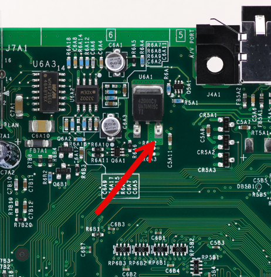
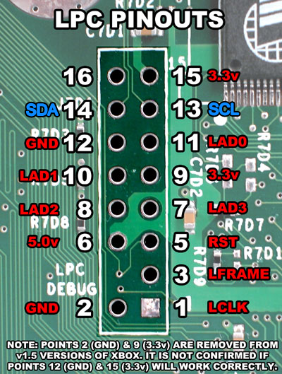
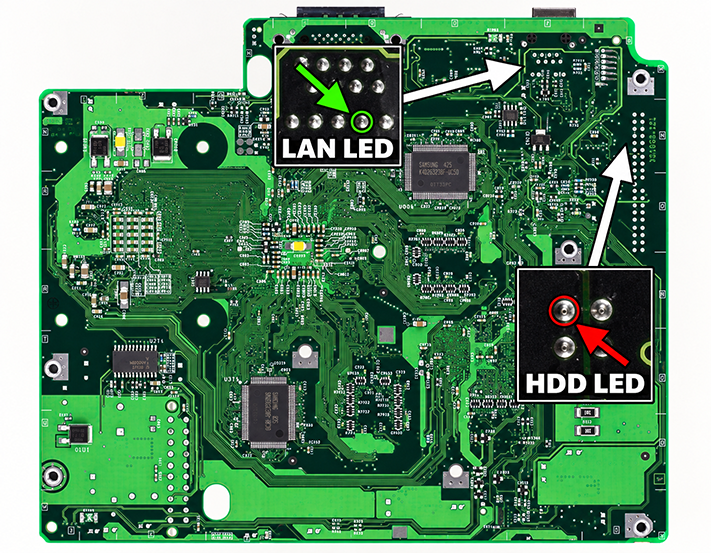
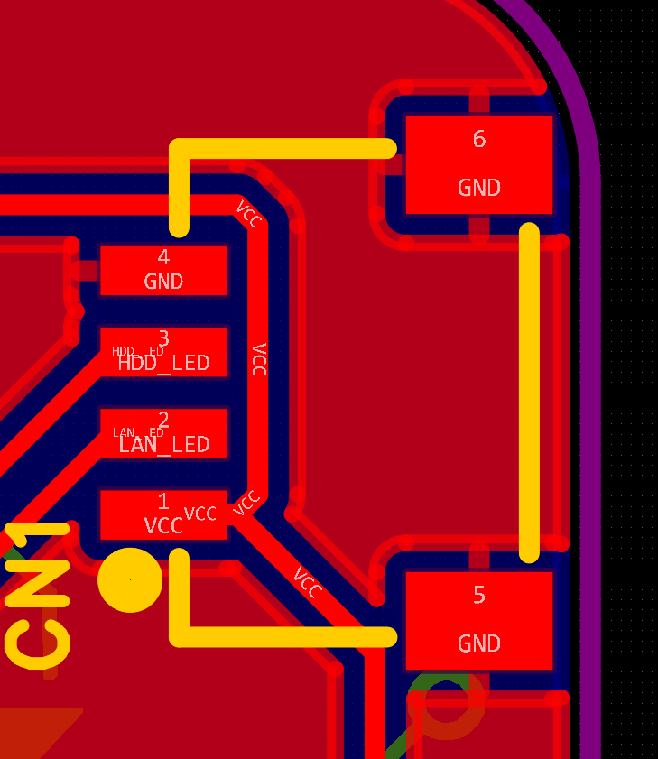

# XAI Installation

This guide covers the basic Xbox-side wiring required to install XAI.

XAI needs four connections from the Xbox motherboard:

- **5V**
- **GND**
- **LAN activity**
- **HDD activity**

The XAI main board can then be mounted in a safe location inside the Xbox, with the FPC cable routed to the front LED board.

> Disconnect power from the Xbox before soldering or connecting XAI.

## 1. 5V and Ground

For simplicity, use the Xbox **LPC header** for power and ground.

Use:

- **LPC Pin 6 — 5V**, **1.6 / 1.6b use alt switched 5V point.**
- **LPC Pin 12 — GND**

These points are suitable across Xbox motherboard revisions, including later boards where some other LPC power/ground pads are not populated.

## 2. LAN and HDD Activity

The LAN and HDD activity signals are available from the underside of the Xbox motherboard.

Use the locations shown below:

- **LAN LED** — connect to the XAI LAN input
- **HDD LED** — connect to the XAI HDD input

These locations are used for the LAN and HDD activity signals across Xbox motherboard revisions.

## 3. Connect the XAI Main Board

Connect the four Xbox-side wires to the XAI SH connector/harness:

| Xbox Connection | XAI |
|---|---|
| LPC Pin 6 | 5V |
| LPC Pin 12 | GND |
| LAN LED point | LAN |
| HDD LED point | HDD |

After the four connections are made:

1. Mount the XAI main board in a safe location inside the Xbox.
2. Connect the FPC cable between the XAI main board and LED board.
3. Route the FPC cable toward the front panel.
4. Mount the LED board in its final position.
5. Reassemble and test the Xbox.

## Notes

- Double-check the connector orientation before powering the Xbox.
- Keep wiring short and secure where practical.
- Make sure no exposed solder joints can contact the Xbox chassis or shielding.
- XAI settings and LED behavior are configured using the button on the front LED board.

For firmware, controls, and flashing instructions, see the main project README.
